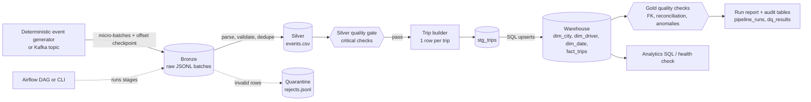

# Architecture

## Design decisions

| Decision | Rationale | Trade-off |
|---|---|---|
| Medallion layers (bronze/silver/gold) | Raw data is never mutated; every downstream table can be rebuilt | More storage than a single ETL hop |
| Bronze checkpoint = source offset, batch file name = offset range | Re-ingesting a range rewrites identical files => idempotent; lost checkpoint replays identically | Kafka source assumes one partition |
| Silver is a full deterministic rebuild from bronze | Idempotent and simple to reason about | Cost grows with history; partition by day for large volumes |
| Quality gate between silver and warehouse | Bad data never reaches consumers; failures are explicit and audited | A bad batch blocks the run until fixed (by design) |
| Warehouse loads via staging + SQL `ON CONFLICT` upserts | Re-runs are no-ops; late updates correct earlier rows | SQLite dialect; no hard-delete propagation |
| Surrogate keys on dims, degenerate `rider_id` on the fact | Classic star schema, pseudonymous rider data | Dimensions are Type-1 (no history) |
| pandas for transforms | Right-sized for the sample scale; keeps the project runnable anywhere | For >10 GB/day the same logic should move to Spark (not implemented here) |

## Grain and model

* `fact_trips` - one row per `trip_id` (status: completed / cancelled / open)
* `dim_city`, `dim_driver`, `dim_date` - conformed dimensions with surrogate keys
* `stg_trips` - per-run staging; `pipeline_runs`, `dq_results`, `schema_migrations` - operational tables

## Failure modes covered

| Failure | Behaviour |
|---|---|
| Malformed / invalid records | Quarantined with reason + bronze file/line pointer |
| Duplicate / out-of-order events | Duplicates dropped (first wins); trip builder is order-independent |
| Source missing or truncated | `SourceError`, run recorded as failed |
| Corrupt checkpoint | `IngestError` - never silently restarts from zero |
| Reject rate above threshold | Critical gate fails, warehouse untouched, failure audited |
| Crash mid-run | Atomic file writes; re-run converges (idempotent stages) |
| Slow run | SLA warning check recorded in the run report |
